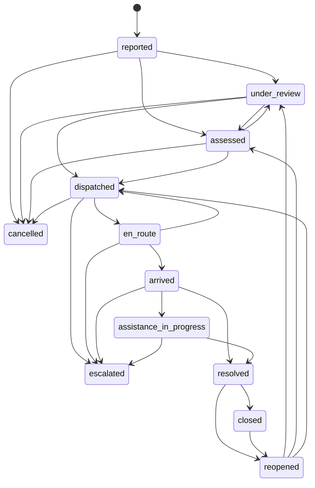

# AI-Based Emergency Response System

> **ACADEMIC DEMONSTRATION PROTOTYPE**  
> *Design and prototype plan for incident reporting, AI-assisted triage, dispatcher-approved assignment, and live status tracking.*  
> **Disclaimer:** This prototype is built for academic evaluation only. It is **not** connected to actual 911/112/100 dispatch centers and does not dispatch real personnel.

---

## 1. Overview & Architecture

The **AI-Based Emergency Response System** provides an end-to-end coordinated workflow for handling emergency incidents:
1. **Citizen Reporting Portal**: Form intake with field validation, location coordinate/landmark selector, and live tracking ticket.
2. **AI-Assisted Triage Engine**: Transparent rule-based classifier evaluating keyword lexicons, domain ambiguity penalties, confidence vs. uncertainty metrics, and recommended responder unit types.
3. **Dispatcher Command Center**: Incident priority queue, duplicate candidate warnings, proximity-ranked unit recommendations with Haversine distance calculations, and human-in-the-loop dispatch authorization.
4. **Responder MDT Terminal**: Role-based mobile terminal for emergency units with status progression stepper (`en_route` &rarr; `arrived` &rarr; `assistance_in_progress` &rarr; `resolved`) and GPS telemetry simulation.
5. **Tactical Radar & Event Audit Stream**: Geospatial 2D radar view and immutable chronological audit log delivered via WebSockets.

---

## 2. Project Structure

```
ai-emergency-response/
├── backend/
│   ├── app/
│   │   ├── api/
│   │   │   ├── incidents.py        # Intake, list, status transitions, dispatch assignment
│   │   │   ├── units.py            # Response unit fleet, nearby search, telemetry
│   │   │   └── assess.py           # On-demand AI triage assessment
│   │   ├── services/
│   │   │   ├── classifier.py       # AI triage engine & uncertainty evaluation
│   │   │   ├── duplicate_detector.py # Text & Haversine spatial duplicate detection
│   │   │   ├── lifecycle.py        # Strict state machine transition validation
│   │   │   └── websocket_manager.py # Real-time broadcast connection manager
│   │   ├── models/
│   │   │   ├── incident.py
│   │   │   ├── unit.py
│   │   │   └── event.py
│   │   ├── schemas/
│   │   │   ├── incident.py         # Pydantic request & response models
│   │   │   └── unit.py
│   │   ├── database.py             # SQLite persistence & initial unit seeder
│   │   └── main.py                 # FastAPI application, CORS & static mount
│   └── tests/
│       ├── test_api.py             # API endpoint integration tests
│       ├── test_classifier.py      # Classifier urgency & uncertainty tests
│       └── test_lifecycle.py       # Lifecycle transition rule tests
├── client/
│   ├── index.html                  # Multi-view web portal (Citizen, Dispatcher, MDT, Radar)
│   ├── index.css                   # Glassmorphism dark-theme styling
│   └── app.js                      # WebSocket client & interactive logic
├── docker-compose.yml              # Multi-container orchestration (FastAPI + PostGIS)
├── Dockerfile                      # Production container image
├── requirements.txt                # Python dependencies
├── .env.example                    # Environment configuration template
└── run.sh                          # One-command verification and launch script
```

---

## 3. Incident Lifecycle Transitions

The backend strictly enforces the permitted state transitions. Any invalid status jump is rejected with `HTTP 400 Bad Request`:



---

## 4. API Endpoints Summary

| Method | Endpoint | Description |
| :--- | :--- | :--- |
| `GET` | `/health` | Service health status, database connection, and disclaimer |
| `POST` | `/incidents` | Submit emergency report, run AI triage & duplicate check |
| `GET` | `/incidents` | List incidents with filters (`status`, `category`, `urgency`) |
| `GET` | `/incidents/{id}` | Detailed incident record with AI assessment & duplicates |
| `GET` | `/incidents/{id}/events` | Chronological audit log of all incident transitions |
| `POST` | `/incidents/{id}/assess` | Re-run or refresh AI classification |
| `POST` | `/incidents/{id}/assign` | Dispatcher authorizes unit assignment |
| `PATCH` | `/incidents/{id}/status` | Validated status transition |
| `GET` | `/units` | List all response units |
| `GET` | `/units/nearby` | Proximity query by latitude & longitude with ETA |
| `PATCH` | `/units/{id}/location` | Update simulated unit GPS telemetry |
| `PATCH` | `/units/{id}/status` | Update responder unit availability status |
| `WS` | `/ws/incidents` | Live WebSocket update channel for connected clients |

---

## 5. Quick Start & Execution

### Running Locally with Bash
```bash
./run.sh
```
This automatically initializes the virtual environment, executes the test suite, and starts the server at `http://localhost:8000`.

### Running Tests Individually
```bash
PYTHONPATH=backend ./venv/bin/pytest backend/tests/ -v
```

### Accessing the Web Application
Open your browser to:
- **Frontend Web Portal (via Docker)**: [http://localhost:3000](http://localhost:3000)
- **Direct Backend & API Docs**: [http://localhost:8000](http://localhost:8000) / [http://localhost:8000/docs](http://localhost:8000/docs)
- **PostgreSQL / PostGIS Database (via Docker)**: `localhost:5433`

### Running with Docker Compose
To launch all services (Frontend Nginx, FastAPI Backend, PostGIS DB):
```bash
docker compose up --build -d
```
All 3 containers will start in the background:
1. `emergency_response_frontend` (`http://localhost:3000`)
2. `emergency_response_api` (`http://localhost:8000`)
3. `emergency_response_postgis` (`localhost:5433`)
